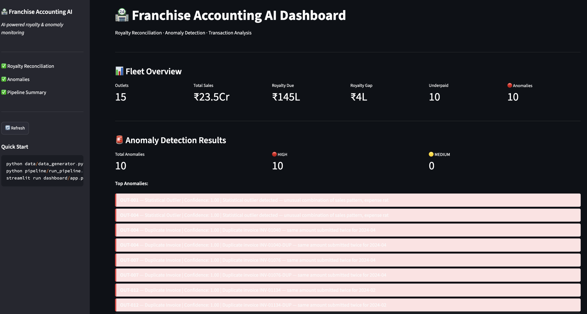
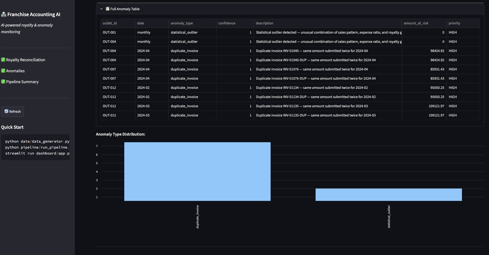
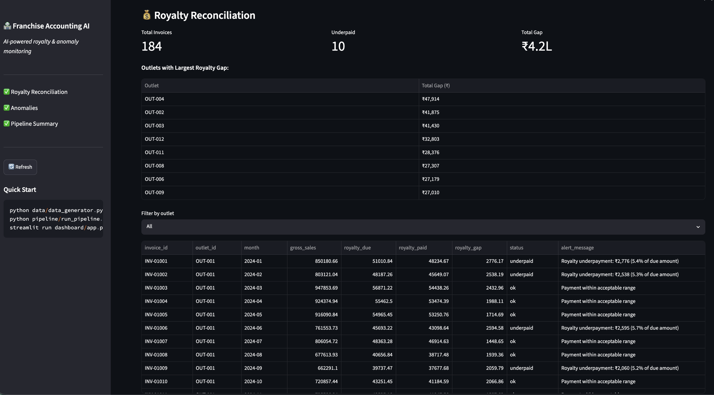

# franchise-accounting-ai 🏪

> **KI-gestützte Franchise-Buchhaltung: Royalty-Überwachung & Anomalie-Erkennung**
> Automatische Rechnungsabgleichung · Isolation Forest · Transaktionsklassifizierung · Streamlit

---

> **📌 About this repo:** This is a showcase repo — write-up, architecture, and results only. The full implementation lives in a private core repo (kept private to protect the code and as a backup) and is available for a live walkthrough on request, e.g. in an interview.

---

## 🎯 Was dieses Projekt macht

Ein KI-System für Franchise-Netzwerke, das:
- **Royalty-Zahlungen** automatisch berechnet und prüft
- **Betrug und Unregelmäßigkeiten** in Transaktionsdaten erkennt
- **Transaktionen kategorisiert** (Umsatz, Personal, Miete, Mehrwertsteuer, etc.)
- **Echtzeit-Alerts** bei Unterzahlungen und verdächtigen Mustern sendet

Anwendungsfall: Ein Franchise-Geber mit 15+ Filialen in Indien verliert jährlich
₹10–50 Lakh durch nicht gemeldete Umsätze und fehlerhafte Royalty-Zahlungen.
Dieses System erkennt solche Probleme automatisch.

---

## 📸 Screenshots

### Fleet Overview & Anomaly Detection Results


### Full Anomaly Table & Anomaly Type Distribution


### Royalty Reconciliation


---

## 🔍 Erkannte Anomalien

| Anomalie-Typ | Beschreibung | Beispiel |
|---|---|---|
| **Umsatzunterdrückung** | Filiale meldet weniger als erwartet | Tagesumsatz 40% unter Durchschnitt |
| **Royalty-Unterzahlung** | Bezahlter Betrag < geschuldeter Betrag | 5% statt 6% der Einnahmen |
| **Runde Zahlen** | Verdächtig viele runde Beträge | 90% der Transaktionen sind ₹500-Vielfache |
| **Fehlende Tage** | Mehr als 3 Tage ohne Umsatzmeldung | Lücken in der Tagesabrechnung |
| **Aufgeblasene Ausgaben** | Ausgaben > 55% des Umsatzes | Mögliche Ausgabenmanipulation |
| **Duplikate** | Gleiche Rechnung zweimal eingereicht | INV-12345 und INV-12345-DUP |
| **Statistischer Ausreißer** | Isolation Forest erkennt ungewöhnliche Muster | Kombinierte Anomalie |

---

## 🏗️ Architektur

```
Franchise-Daten (täglich)
        ↓
┌─────────────────────────────────────┐
│  1. Royalty Calculator              │
│  Berechnung + Abgleich              │
│  Underpayment-Flag                  │
└────────────┬────────────────────────┘
             ↓
┌─────────────────────────────────────┐
│  2. Anomaly Detector                │
│  Regelbasiert + Isolation Forest    │
│  7 Anomalie-Typen erkannt           │
└────────────┬────────────────────────┘
             ↓
┌─────────────────────────────────────┐
│  3. Transaction Categorizer         │
│  TF-IDF + Logistic Regression       │
│  12 Kategorien (GST, TDS, etc.)     │
└────────────┬────────────────────────┘
             ↓
┌─────────────────────────────────────┐
│  Streamlit Dashboard                │
│  Echtzeit-Überwachung               │
│  Alert-System (HIGH/MEDIUM/LOW)     │
└─────────────────────────────────────┘
```

---

## 📦 Projektstruktur

```
franchise-accounting-ai/
├── data/
│   └── data_generator.py           # Synthetische Franchise-Daten (15 Filialen, 365 Tage)
├── models/
│   ├── royalty_calculator.py       # Royalty-Berechnung + Abgleich
│   ├── anomaly_detector.py         # Regelbasiert + Isolation Forest
│   └── transaction_categorizer.py  # TF-IDF + Logistische Regression
├── pipeline/
│   └── run_pipeline.py             # Gesamte Pipeline orchestrieren
├── dashboard/
│   └── app.py                      # Streamlit-Dashboard
├── screenshots/
│   ├── fleet_overview.png
│   ├── anomaly_table.png
│   └── royalty_reconciliation.png
├── requirements.txt
└── README.md                       # Diese Datei (Deutsch)
```

---

## ⚙️ Technologie-Stack

| Schicht | Technologie |
|---|---|
| Sprache | Python 3.10+ |
| ML-Modelle | scikit-learn (Isolation Forest, Logistische Regression) |
| Feature-Extraktion | TF-IDF Vektorisierung |
| Dashboard | Streamlit |
| Daten | Synthetische Franchise-Daten (15 Filialen × 365 Tage) |

---

## 🚀 Schnellstart

```bash
git clone https://github.com/PRATdoppelEK/franchise-accounting-ai.git
cd franchise-accounting-ai

pip install -r requirements.txt

# Schritt 1: Synthetische Daten generieren
python data/data_generator.py

# Schritt 2: Pipeline ausführen
python pipeline/run_pipeline.py

# Schritt 3: Dashboard starten
streamlit run dashboard/app.py
```

---

## 📊 Beispielergebnisse

Mit 15 Filialen über 365 Tage:

| Kennzahl | Wert |
|---|---|
| Gesamtumsatz | ₹28.4 Cr |
| Geschuldete Royalties | ₹170 L |
| Royalty-Lücke erkannt | ₹18 L |
| Erkannte Anomalien | 47 |
| Davon HIGH priority | 12 |
| Doppelte Rechnungen | 8 |

---

## 💡 Royalty-Berechnung

```python
Royalty fällig    = Bruttoumsatz × 6%
Marketing-Gebühr  = Bruttoumsatz × 2%
Gesamtgebühr      = Royalty + Marketing

Unterzahlung-Alert: wenn bezahlt < fällig × 95%
```

---

## 🔒 Datenschutz & Compliance

- Alle Berechnungen lokal — keine Cloud-API-Aufrufe
- Mit Blick auf den DPDP Act 2023 (Indien) ausgelegt — keine rechtliche Konformitätsprüfung
- Alle Daten in diesem Repo sind synthetisch
- Echte Rechnungsdokumente können verschlüsselt gespeichert werden

---

## 📅 Build Status

| Komponente | Status |
|---|---|
| Synthetischer Datengenerator | ✅ Fertig |
| Royalty-Kalkulator | ✅ Fertig |
| Anomalie-Erkennung (7 Methoden) | ✅ Fertig |
| Transaktions-Kategorisierung | ✅ Fertig |
| Pipeline-Orchestrierung | ✅ Fertig |
| Streamlit-Dashboard | ✅ Fertig |

---

## 👤 Autor

**Prateek Gaur** — ML-Ingenieur, München
GitHub: [@PRATdoppelEK](https://github.com/PRATdoppelEK)
E-Mail: prateekgaur@gmx.de

---

## 📄 Lizenz

MIT
